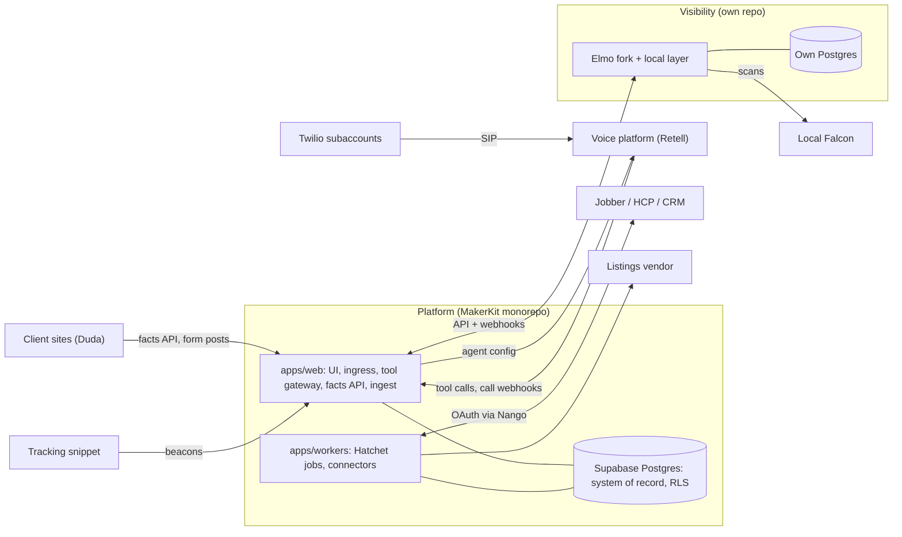

# Architecture and decisions

## System boundaries

The product is a few systems, each with one owner. The MakerKit monorepo is **the platform**, not the whole product. Systems connect through versioned APIs, signed webhooks and SIP, never through a shared database (ADR-31).



| System | Owns | Codebase and runtime | Users |
| --- | --- | --- | --- |
| **Platform** | Tenancy and every client login; system of record for the contact index, consents, conversations, calls, reviews, usage and canonical facts; send gate; tool gateway; connectors; inbox; dashboards; later the analyst | `platform` repo (MakerKit Turborepo + pnpm): Next.js on Vercel, Hatchet workers on Fly.io, Supabase | Agency staff, client owners and staff |
| **Visibility** | Prompt sets, AI answers, geo-grid scans, citations, competitor sets, gap analysis, AEO reports for clients and prospects | `visibility` repo: Elmo fork (MIT, rebranded) plus our local layer; its own Postgres and job runner; Fly.io | Agency staff; public, revocable report links |
| **Voice runtime** | Live phone conversations; nothing authoritative | Hosted (Retell, ADR-26), configured from `platform/packages/voice-agent`; a `voice-runtime` repo (Python) only when E55 triggers | Callers |
| **Client sites** | Site page content | White-label builder (Duda-class) now; a `sites` repo only if the build-later trigger fires | Website visitors |
| **Tracking snippet and ingest** | First-party attribution capture on client sites | `platform/packages/tracking`, published to a CDN as a versioned public contract; ingest route on its own subdomain in `apps/web`, moving to an edge deployable in Phase 6 | Website visitors |

**Outside the product:** the agency marketing site, internal ops automations (n8n, internal use only) and my own sales pipeline. These can call platform APIs like any integration. They never live in the platform repo.

### When to split

- **Separate repo and deployable** when any of these is true: a different language or runtime; built on third-party code we want to keep syncable with upstream; serves people who aren't platform tenants; must not hold platform database credentials; a different release cadence.
- **Same repo, separate deployable** when it shares the language, the domain types and the database but has a different scaling profile or blast radius. Web and workers are the example.
- **Module inside a deployable** for everything else. Connectors, inbox, CRM adapters, the review engine and the analyst all write the system of record and must sit behind RLS and the send gate.
- **Don't split for its own sake.** Each boundary is a contract to version and an integration to test. The wedge has two codebases: platform and visibility.

### Data ownership

| Data | System of record | Copies |
| --- | --- | --- |
| Tenants, users, roles | Platform | — |
| Contact index, consents, conversations, calls, transcripts, recordings, reviews, usage | Platform | Voice platform holds call data only transiently (retention set to minimum) |
| Jobs, quotes, invoices, client CRM records | Client's FSM/CRM, or our native CRM when chosen (ADR-23) | `revenue_events` in the platform |
| Canonical facts | Platform (`kb_facts`) | Pushed to listings vendor; served to the voice agent through tools; read by visibility and sites through the facts API |
| AI answers, scans, citations, prompt sets, competitors, reports | Visibility | Monthly summaries in the platform's `visibility_snapshots` |
| Directory listing state | Listings vendor | Drift results imported into the platform |
| Site page content | Site builder | — |

### Integration contracts

| From → to | Mechanism | Contract | Auth |
| --- | --- | --- | --- |
| Twilio → voice platform | Elastic SIP trunk per location subaccount | SIP | Trunk credentials / IP allowlist |
| Voice platform → platform | Tool calls to the gateway; call-event webhooks to ingress | Tool manifest served by the gateway (JSON Schema, MCP-compatible); vendor webhook schema | Signature verified; `location_id` resolved server-side from the agent or call ID |
| Platform → voice platform | Agent config push via `VoiceAgentProvider` | Agent templates as code in `packages/voice-agent` | API key per environment |
| Platform ↔ visibility | Platform calls the visibility API (subjects, link/unlink, report URLs); visibility calls the platform facts API; visibility sends `visibility.summary.ready` and `visibility.report.ready` webhooks | OpenAPI in each producer repo; generated TS clients pinned by version; `/v1` paths | Service tokens per environment; HMAC-signed webhooks |
| Sites, listings vendor → platform | Read-only facts API per location; form posts to ingest | OpenAPI | Per-location publishable key (read-only); signed form posts |
| Tracking snippet → platform | HTTPS beacons | Versioned snippet (`/v1/t.js`); payload schema in `packages/domain` | Publishable key per location; rate limits |
| Platform ↔ FSM/CRM | Connectors in workers (ADR-17, ADR-23) | Provider APIs, recorded fixtures | OAuth via Nango (ADR-30) |

**Rules at every boundary**

1. **No shared databases.** No other system reads the platform's Postgres, and the platform never reads Elmo's.
2. **One shared key.** The platform's location `account_id` is the shared key; other systems store it as an external reference.
3. **Client logins only in the platform.** Visibility has agency-staff logins and public report links; sites have none.
4. **Only the platform contacts consumers.** Every SMS, email and call goes through its send gate; other systems ask it to send.
5. **Idempotent writes, durable webhooks.** Every cross-system write carries an idempotency key; every inbound webhook lands in `inbound_webhooks` first (ADR-07).
6. **Producers own contracts.** Contracts are versioned and change by addition; breaking changes run side by side until consumers move.

## Platform internals

Two deployables, the web app and the workers, share one Postgres database and one tool gateway. Every channel therefore behaves the same, and tenant isolation is enforced in the database, not in application code.

&#91;embedded content: system architecture · 5 services, 1 database\]

*The embedded diagram predates ADR-26 and ADR-31. The diagram under "System boundaries" above is current.*

Voice and chat never touch the database directly for business actions; they call the tool gateway. Text agents use short-lived, location-scoped tokens. The voice platform's calls are verified by signature, and the gateway resolves the location from its own record of the agent or call. Workers write as a dedicated role that RLS still constrains. Domain events leave the database only through the outbox.

## Repositories and environments

### Platform repo (MakerKit Turborepo + pnpm, TypeScript only)

```
apps/
  web/            MakerKit Next.js: agency + client UI, server actions, webhook ingress,
                  tool gateway + manifest, public facts API, ingest route (own subdomain)
    supabase/     migrations, seed, generated types, pgTAP RLS tests (ADR-25: no packages/db)
  workers/        Node + Hatchet: workflows, connectors, outbox relay, usage rating, imports
  mobile/         Later: Expo kit sharing Supabase + RLS
packages/
  domain/         entity types, zod schemas, versioned domain events and webhook envelopes
  tools/          agent tool definitions (zod → JSON Schema manifest served by the gateway)
  connectors/     jobber, gbp, google-calendar, stripe (hcp later): one module each; OAuth via Nango
  telephony/      TelephonyProvider + Twilio implementation (numbers, messaging, calls, SIP trunks)
  voice-agent/    VoiceAgentProvider + Retell implementation; agent templates as code (from M3)
  visibility-client/  generated client for the visibility API
  tracking/       tracking snippet, built and published to a CDN separately, versioned
  ai/             LLM gateway for text agents, prompt registry, eval harness, Langfuse wiring
  ui/             MakerKit UI kit
```

Removed from the Nov 4 layout:
- `apps/voice` → becomes a `voice-runtime` repo, only with E55.
- `apps/sites` → bought builder; becomes a `sites` repo only on its trigger.
- `packages/aeo-core` → the engine stays in the visibility repo (ADR-31).
- `packages/db` → removed per ADR-25.

### Visibility repo

```
(Elmo upstream layout, rebranded; MIT copyright and license notices kept)
src/local/          our local layer: prompt templates, business matching, competitor
                    discovery, gap reports, report pages
src/providers/      VisibilityProvider adapters: Elmo's scraping/API providers, Local Falcon
src/api/v1/         service API (OpenAPI) and signed webhook sender to the platform
src/db/             withSubject() wrapper, RLS policies, pgTAP isolation tests
scripts/upstream-diff   compare against upstream Elmo before each sync
```

### Later repos (only when their trigger fires)

- `voice-runtime` (Python + uv, Pipecat or LiveKit Agents; E55). It consumes the gateway's published tool manifest; there's no shared code generation with the platform.
- `sites` (multi-tenant Next.js with a Puck editor). It reads only the public facts API and never holds platform database credentials.

**Contract rule:** contracts live with their producer. The tool manifest and domain events are defined in platform `packages/tools` and `packages/domain` (zod → JSON Schema). The visibility API is defined in OpenAPI in the visibility repo. Consumers use generated clients pinned to a version. CI fails if a producer's generated spec is stale, or if a change breaks the previous version's recorded fixtures.

| Environment | Database | Web | Workers | Voice | Visibility | Telephony | Purpose |
| --- | --- | --- | --- | --- | --- | --- | --- |
| Local | `supabase start` (Docker) | `next dev` | Local process + Hatchet dev | Retell dev workspace (from M3) | Local Elmo + Postgres | Twilio dev subaccount + tunnel | Daily development |
| Preview | Supabase branch per PR | Vercel preview | Not deployed (mocks) | Mocked provider | Mocked client | Mocked provider | PR review, E2E tests |
| Staging | Supabase project (staging) | Vercel staging | Fly.io staging | Retell staging workspace | Fly.io staging, own Postgres | Twilio staging subaccount + one real number on a SIP trunk | Pre-release checks, nightly voice calls |
| Production | Supabase Pro (PITR on) | Vercel production | Fly.io production (iad) | Retell production workspace | Fly.io production, own Postgres with backups | Twilio ISV, subaccount per location, SIP trunk per location | Clients |

- Platform migrations run in CI against a fresh database plus the RLS test suite before any deploy. Production migrations are forward-only and backward-compatible for one release (expand → migrate → contract).
- Secrets live in one manager (Doppler or 1Password Secrets Automation) and sync to Vercel, Fly and GitHub Actions for both repos; never in committed or shared `.env` files.
- Feature flags (PostHog) gate every AI behavior per location. A kill switch drops calls to voicemail and text-back at the Twilio level, so it works even when the voice platform is down.

## Architecture decision records

These are the decisions to lock in before writing feature code. Each names what would make me revisit it. New decisions get a row here (or a `docs/adr/NNNN-*.md` file in the repo) before the code that depends on them.

| ID | Decision | Choice | Alternatives considered | Why | Revisit when |
| --- | --- | --- | --- | --- | --- |
| ADR-01 | Monorepo | MakerKit Turborepo + pnpm for **the platform only**, TypeScript only. Visibility and any later voice runtime or sites live in their own repos (amended by ADR-26, ADR-31) | One repo for everything; separate repos per app | One PR can change a tool schema, the gateway and the web caller together; other systems integrate through versioned contracts | Platform build times hurt CI |
| ADR-02 | System of record | Supabase Postgres (managed Pro, PITR) | Self-hosted Postgres; Neon + separate auth | RLS, pgvector, Realtime, Storage and auth in one; plain Postgres exit path | Cost or noisy-neighbor limits at \~200 locations |
| ADR-03 | Tenancy model | Shared schema; location `account_id` on every tenant table; RLS (detail in ADR-25) | Schema-per-tenant; DB-per-tenant | One migration path; agency → location access via MakerKit's helpers | A client requires data residency or a dedicated DB |
| ADR-04 | Worker data access | Workers connect as a dedicated `app_worker` role, not `service_role`; `withLocation(id, fn)` runs `SET LOCAL app.location_id`, and RLS policies honor it | Service role + manual filters | RLS protects background code too; a forgotten filter fails closed | Bulk cross-tenant jobs (rating) need a separate audited role |
| ADR-05 | Durable jobs | Hatchet (Cloud first, self-host later on its own Postgres) for the platform; visibility keeps Elmo's own job runner | pg-boss, Trigger.dev, Temporal, Inngest | Durable sleeps, retries, concurrency keys per location, MIT license | Cost or a missing primitive; pg-boss is the fallback |
| ADR-06 | Reliable events | Transactional outbox table; relay publishes to Hatchet with event IDs for idempotency | Postgres triggers calling HTTP; direct enqueue in request | No lost or phantom events when a request fails mid-way | Event volume needs a log (e.g., Redpanda) |
| ADR-07 | Webhook ingress | Next.js route handlers: verify signature → store raw in `inbound_webhooks` (unique provider event id) → 200 → enqueue. Also used for voice platform and visibility webhooks | Process inline | Fast acks, dedupe, and replay of any provider event | Ingress volume exceeds serverless limits |
| ADR-08 | Hosting | Web on Vercel; workers and visibility as containers on Fly.io (iad); voice hosted by the platform vendor (ADR-26) | AWS ECS/Fargate; Render; Railway | Low ops for one person; portable containers | SOC 2 or enterprise asks for AWS |
| ADR-09 | Telephony | Twilio ISV account, one subaccount per location, behind a `TelephonyProvider` interface (numbers, messaging, calls, SIP trunks) | Telnyx; SignalWire; Plivo | Most mature Trust Hub/A2P APIs; subaccounts isolate usage and billing; numbers stay ours even with a hosted voice platform | Margin pressure: add Telnyx for voice minutes (E55) |
| ADR-10 | Voice pipeline | **Deferred by ADR-26.** Target design for E55: Twilio/Telnyx media → Pipecat or LiveKit → VAD + smart-turn → streaming STT → tool-calling LLM → TTS | Speech-to-speech realtime models | Control over cost per minute and vendor swaps once volume justifies it | E55 trigger in ADR-26 |
| ADR-11 | Shared agent tools | One tool gateway (HTTP, MCP-compatible) owned by the web app, publishing its tool manifest. Text agents call it with short-lived, location-scoped tokens; the voice platform with signed requests resolved to a location server-side. Every call audited | Tools re-implemented per channel; vendor-native functions with business logic | One behavior for booking, lookups and transfers across channels and voice vendors | Gateway latency exceeds \~100 ms p95 server time |
| ADR-12 | LLM access | Text agents: Vercel AI SDK, model per task, traced in Langfuse, prompts versioned in repo. Voice: the LLM runs inside the voice platform, with prompts from our agent templates and call traces pulled from its call records | Single-provider SDK; LiteLLM proxy | Route cheap vs. smart models per task; swap vendors without rewrites | Need for org-wide rate limiting → add a proxy |
| ADR-13 | Retrieval | pgvector HNSW + Postgres full-text, fused with reciprocal rank fusion; `kb_facts` authoritative for prices, hours and areas; the voice platform's own knowledge base is not used | Dedicated vector DB; pure vector search; vendor KB | Hybrid beats either alone for names and part numbers; facts prevent hallucinated prices | Corpus per location exceeds \~1M chunks |
| ADR-14 | Realtime UI | Supabase Realtime Broadcast fed from database triggers, per-location channels | `postgres_changes` subscriptions | Broadcast scales better and respects channel authorization | Fan-out limits hit |
| ADR-15 | Money and usage | **Amended by ADR-29:** `usage_events` (integer micros) are the record; a monthly rating job pushes invoice items to Stripe Billing; double-entry ledger deferred; Stripe Connect Express for client payments | Stripe Meters / Metronome; full ledger now | Per-location cost transparency with the least code | ADR-29 triggers |
| ADR-16 | Secrets and tokens | **Amended by ADR-30:** connector OAuth via Nango Cloud; app secrets in Doppler/1Password; recordings in private buckets, signed URLs; Supabase Vault as fallback for tokens | Own OAuth vault now | Less token-refresh code across many providers | ADR-30 triggers |
| ADR-17 | Connector design | In-house connector SDK: `connect` (via Nango), `backfill`, `ingest`, `push`, `reconcile`; GraphQL codegen for Jobber; per-provider rate limiter | Unified API vendors | FSM data is the product's core; I need full control and fidelity | A vertical gets a good unified API |
| ADR-18 | Email | Postmark for transactional and inbound parse; campaign sending vendor chosen at Phase 3 (hosted broadcast sending preferred over running our own SES reputation; ADR-27 register), on separate sending domains per client | One provider for both | Protects transactional deliverability from campaign reputation | Volume or cost shifts |
| ADR-19 | Observability | Sentry, OpenTelemetry traces (Grafana Cloud or Honeycomb), Langfuse for LLM traces/evals, PostHog for product and flags; `location_id` on every span and log, in both repos | Datadog | Cheap at small scale; vendor-neutral traces | Spend or SOC 2 tooling needs |
| ADR-20 | Frontend data | MakerKit server components + server actions; client components with Supabase Realtime for the inbox; PWA (Serwist) with Web Push | Separate SPA | Least code; MakerKit patterns; native later via Expo kit | Field techs need offline |
| ADR-21 | Analytics | Materialized views in Postgres refreshed by jobs; typed metric registry; Cube Core later | ClickHouse now | Volume is small for years | Report queries exceed \~2 s |
| ADR-22 | Bought vs. built data | Buy SERP/AI-answer data behind a `VisibilityProvider` interface; **extended by ADR-28** (Elmo providers + Local Falcon, in the visibility repo) | Own scrapers | Scraping AI apps is brittle and terms-sensitive | Vendor coverage or cost fails |

### ADR-23: Bring your own system of record

**Decision:** every feature talks to a `CrmAdapter` interface, never straight to our CRM tables. Each location sets `crm_mode` (integrated, native or hybrid). Our native CRM is just one adapter, and anyone can turn it on, including clients who also run Jobber or Housecall Pro.

**Alternatives rejected:**
- Always running our CRM and syncing to theirs: double entry and conflicting edits, which is exactly the GHL problem.
- Building features directly on the client's API: every feature re-implemented per vendor.

**Revisit when:** a common CRM lacks the capabilities below, and a unified CRM API vendor becomes cheaper than another adapter (check license and terms, e.g. Nango's Elastic 2.0).

| Capability | Used for | Fallback when missing |
| --- | --- | --- |
| `contacts.lookup` (phone, email) | Caller ID, inbox threading, match before create | Contact index only |
| `contacts.create` | Agent captures a new caller | Create in native index; flag for owner |
| `requests.create` / `jobs.create` | Agent booking | SMS the owner the request details |
| `jobs.read`, `quotes.read`, `invoices.read` | Revenue graph, review triggers, analyst | Manual "job done" button |
| `availability.read` | Real-time booking | "Request + owner confirms" |
| `activities.write` (notes, timeline) | Write-back of call summaries and messages | Daily email digest to the owner |
| `webhooks` | Near-real-time sync | Polling every 5–15 minutes |
| `fields.write` (tags, custom fields) | Hybrid-mode two-way sync | One-way: ours stays local |

**Adapter tiers**

1. **Deep:** Jobber, Housecall Pro (and our native CRM): every capability, contract-tested.
2. **Standard:** ServiceTitan (partner program), HubSpot and others added by client demand: lookup, create, activities, webhooks.
3. **Generic:** a webhook adapter any CRM can use (we call a lookup URL; we post activity events to theirs), plus Zapier for the long tail.

Every adapter passes the same contract test suite before it ships. The UI shows or hides features based on the adapter's declared capabilities.

### ADR-24: Elmo for AI-visibility tracking

**Amended by ADR-28 and ADR-31:** the engine is no longer extracted into the platform. Elmo is the base of the separate visibility repo, and our local layer is built there.

**Decision (original):** run [Elmo](https://github.com/elmohq/elmo) self-hosted and rebranded from day one for AEO audits. Local search is our own layer and stays private.

**Why:** Elmo already does scheduled prompt runs against consumer AI surfaces (through scraping providers) and model APIs. It captures answers, citations and the searches engines run, stores raw output in Postgres, and computes mention, sentiment, share-of-voice and citation metrics. Its app is TanStack Start with pg-boss and its own auth. That's fine for an agency-internal service and the wrong shape to merge into the platform.

**License:** MIT. Keep the copyright and license notice in copied files. Their name and logo aren't licensed, so rebrand. Their contributor agreement only applies if we send changes upstream.

**Dependency to wrap:** mention and sentiment judging uses TypeSafe's Jev (paid, roughly $0.15–$0.35 per 1,000 answers). It sits behind a `MentionJudge` interface so our own LLM judge plus an eval set can replace it.

**Revisit when:** upstream diverges so far that syncing costs more than it saves (then E53-S11 replaces Elmo internals inside the visibility repo), or Elmo adds local search itself.

### ADR-25: Agency and location tenancy on MakerKit accounts

Accepted 2026-11-05; full text in `adr-0025-agency-location-tenancy.md`. In short: agency and location are MakerKit team accounts with `kind` and `parent_account_id`; client tables use `account_id` pointing to a location; copied agency memberships arrive in Core v1. Where older text says `location_id`, read the location `account_id`.

### ADR-26: Hosted voice-agent platform for the receptionist

**Status:** Accepted 2026-11-05. Supersedes ADR-10 for Core v1.

**Decision:** run the AI receptionist on a hosted voice-agent platform, reached over a Twilio Elastic SIP trunk from each location's own Twilio subaccount. Retell is first choice and Vapi the fallback; the SP1 bake-off picks one.

**What stays ours:**
- the tool gateway and tool manifest (ADR-11)
- canonical facts
- agent templates (versioned in the platform repo, pushed through the `VoiceAgentProvider` interface)
- eval scenarios
- routing rules and answer modes
- consent and the send gate
- every call record

**Rules**
- Numbers are bought in our Twilio subaccounts, never from the voice platform. The same number carries SMS and A2P, and Retell-bought numbers can't be moved into our Twilio account.
- The AI disclosure and recording notice are a fixed first message, not model-generated.
- The platform's own SMS, knowledge base and phone numbers are not used. Texts go through the send gate, prices and hours come only from `get_facts`, and outbound dials happen only after the send gate approves (E35).
- Every tool call is verified by signature, and `location_id` is resolved from our record of the agent or call, never from model arguments.
- Call-event webhooks land in `inbound_webhooks` (ADR-07). Transcripts, summaries, intent and recordings are copied into platform storage, platform-side retention is set to minimum, and the platform is listed as a subprocessor.
- Per-call cost from the platform is written to `usage_events`.
- If the SIP leg fails or times out, Twilio falls back to voicemail and text-back; the PostHog kill switch does the same.

**Why:** about 11 focused days of E11 and E05 work disappear, along with the ongoing tuning of turn-taking, interruptions and fillers, which is the hardest part to get right alone. Cost is about $0.11–$0.14 per minute against $0.05–$0.09 self-assembled: roughly $25–30 more per Growth client a month, which is small next to the time saved at 5–20 clients.

**Alternatives considered:**
- Build now on Pipecat (ADR-10): best margin, most time.
- Pipecat Cloud or LiveKit Cloud: managed hosting at about $0.01 per minute, but we still write and tune the pipeline.
- ElevenLabs Agents and other bundled platforms: keep as a bake-off option if Retell and Vapi both disappoint.

**Note:** Deepgram announced the acquisition of Daily, Pipecat's maintainer, on Oct 29, 2026. Pipecat stays BSD-2 with a planned independent foundation. Re-check governance before starting E55.

**Revisit when:**
- AI minutes reach about 20k a month (around 40 Growth clients). At about $0.05 per minute saved, E55 (about 15 days) then pays back within roughly a year.
- The platform raises prices, or blocks something we need: latency we can't fix, custom turn-taking, or data terms.

### ADR-27: Buy-first sourcing

**Status:** Accepted 2026-11-05.

**Decision:** buy a capability when it's commodity and a vendor can sit behind an interface we own. Build it when it sets the product apart or is covered by a rule that doesn't bend. Every buy records the trigger for building it ourselves. Reasoning and evidence are in `buy-vs-build-review.md`.

**Guardrails for every vendor**
1. It never sends SMS, email or calls to consumers outside the send gate.
2. The tenant is resolved on our side, never from a vendor payload field or a model argument.
3. Data we depend on is copied into our own database with the location `account_id` (platform) or `subject_id` (visibility).
4. It sits behind an interface we own, and its costs land in `usage_events`.
5. It's added to the subprocessor list if it touches client customer data.
6. License rules unchanged.

**Register**

| Capability | Now | Interface | Build-later trigger |
| --- | --- | --- | --- |
| Voice real-time layer | Retell (Vapi fallback), ADR-26 | `VoiceAgentProvider` | \~20k AI min/month or a blocking limit → E55 |
| AEO data | Elmo providers + Local Falcon, ADR-28 | `VisibilityProvider` | >\~10 AEO clients or upstream drift → E53-S11 |
| KB crawling | Firecrawl API | `Crawler` | Crawl spend > a small Crawl4AI worker |
| Connector OAuth | Nango Cloud, ADR-30 | Connector SDK `connect` | >\~$200/month or a blocking outage |
| Billing | Stripe invoice items from our rating job, ADR-29 | Rating job | Disputes, prepaid wallets or >\~30 billed locations → E04-S6 |
| A2P registration | By hand + our opt-in page generator | — | >\~2 new clients a month → E07 |
| Booking slots | Jobber request + owner confirms | `CrmAdapter.availability` | No-FSM clients need booking, or confirm lag loses jobs → E15 |
| Workflow builder | Code recipes on Hatchet | Recipe registry | Clients ask to build their own automations |
| Campaign email sending | Hosted broadcast sending (chosen at Phase 3) | `EmailSender` | Volume makes SES clearly cheaper |
| Listing sync and drift | BrightLocal-class vendor | `ListingsProvider` | Bing/Apple partner access and >\~50 locations |
| SEO data | Local Falcon grid + vendor audits | `VisibilityProvider` / `ListingsProvider` | — |
| Client websites | Duda-class white-label builder | Facts API + tracking snippet | \~30 hosted sites, or server-log access needed → `sites` repo |
| DNI call tracking | CallRail-class vendor | `touchpoints` ingest | Vendor cost > own number pools, or deeper session joins needed |
| SOC 2 | Vanta/Drata-class | — | — |
| Kept bought | MakerKit, Hatchet Cloud, Twilio, Postmark, Sentry, PostHog, Langfuse Cloud, hosted status page | — | Per their ADRs |

### ADR-28: AEO data from Elmo plus Local Falcon, inside the visibility service

**Status:** Accepted 2026-11-05. Amends ADR-22 and ADR-24.

**Decision:** the visibility repo runs two kinds of data collection, both behind `VisibilityProvider`:
- **Elmo's providers** for prompt-panel runs on engines Local Falcon doesn't cover: Perplexity, Claude, Copilot and model APIs.
- **Local Falcon** for geo-grid local AI visibility on ChatGPT, Google AI Overviews, AI Mode, Gemini and Grok. Its scans return per-point mentions, competitor brands and cited sources.

Our local layer is built on top of both: prompt templates, business matching, competitor discovery, gap reports and report pages. The platform receives monthly summaries into `visibility_snapshots` (RLS) for the client dashboard and later the analyst. SP5 tests Local Falcon alongside the other vendors.

**Cost:** one Local Falcon credit per grid point; plans start at $24.99 a month for 7,500 credits, and the API is included. Example: 10 prompts × a 5×5 grid × 3 AI engines, monthly, is 750 credits, or a few dollars per client.

**Alternatives rejected:**
- Extracting Elmo's engine into the platform (old ADR-24 plan): about 4 days, and it puts prospects and raw answer volume in the tenant database.
- Building our own geo-grid sampling (old E53-S10).

**Revisit when:** more than about 10 AEO clients, or vendors lose coverage, or upstream Elmo drift makes syncing costly. In each case E53-S11 replaces Elmo internals with our own engine inside the visibility repo.

### ADR-29: Usage billing through Stripe invoice items; ledger later

**Status:** Accepted 2026-11-05. Amends ADR-15.

**Decision:** `usage_events` (integer micros, idempotent on provider IDs) are the record of usage. A monthly rating job applies plan bundles and overage, then pushes invoice items onto each agency's Stripe Billing subscription, with a dry-run mode. No double-entry ledger, Stripe Meters or Metronome for now. Daily reconciliation against Twilio and voice-platform usage stays.

**Why:**
- Stripe moved advanced usage-based billing into Metronome in July 2026; basic Meters remain.
- Pushing invoice items from our own rating job is less code and keeps the per-location cost view ours.
- Stripe Billing charges 0.7% of billing volume, about $3 per Growth client.

**Revisit when:** a billing dispute needs a full audit trail, prepaid wallets or credits are wanted, or more than about 30 locations are billed. Then build E04-S6, the double-entry ledger backfilled from `usage_events`.

### ADR-30: Nango Cloud for connector OAuth

**Status:** Proposed 2026-11-05; becomes accepted when SP6 passes. Amends ADR-16.

**Decision:** connector OAuth goes through Nango Cloud: the connect UI, token storage and refresh, and the authenticated proxy. That covers Jobber, Google Business Profile, Google and Microsoft calendars, later Housecall Pro partner OAuth and QuickBooks. Sync logic, cursors and reconciliation stay in our connector SDK (ADR-17), and each location stores only its Nango connection ID.

**License:** Nango is Elastic 2.0. Using it as a hosted service inside our product is fine; we never resell Nango itself.

**SP6 must confirm:**
- Jobber and Google Business Profile connect and refresh correctly, including a custom provider config if one isn't built in
- the paid-tier price at our connection count
- latency through the proxy

**Fallback:** ADR-16's original design (Supabase Vault, our own refresh job).

**Revisit when:** Nango costs more than about $200 a month, an outage over an hour blocks syncs, or a provider it handles badly becomes critical.

### ADR-31: System boundaries and integration contracts

**Status:** Accepted 2026-11-05. Amends ADR-01 and ADR-24.

**Decision:** the product is split into the systems in "System boundaries" above:
- **Platform** (MakerKit monorepo) and **Visibility** (own repo) now
- **Voice runtime** hosted now, its own repo only with E55
- **Client sites** on a bought builder now, their own repo only on trigger
- **Tracking snippet** as a versioned public package

Systems connect only through the contracts in the integration table, follow the six boundary rules, and use the location `account_id` as the shared key.

**Why visibility is separate:**
- it's built on a third-party codebase we want to keep syncable
- it serves prospects, who must never become tenants
- its batch workloads and raw answer volume don't belong in the operational database
- it can be sold before a client has a platform account

**Why the rest is not split:** connectors, inbox, CRM adapters, the review engine and the analyst write the system of record and must sit behind RLS and the send gate. Workers are a separate deployable in the same repo.

**RLS applies in visibility too.**
- Every visibility table carries `subject_id`, plus `location_id` (the platform location `account_id`) once a subject is linked to a client, and has RLS enabled.
- All database access, including the jobs and the API, goes through `withSubject(id, fn)`, which runs `SET LOCAL app.subject_id`. Policies honor it, so a query without it returns nothing.
- Agency staff read across subjects only through an explicit, audited agency role, the same way agency staff reach locations in the platform.
- The app never uses a bypass role; that's for migrations only.
- pgTAP tests prove cross-subject reads and writes fail (E53-S13).

**Alternatives rejected:**
- Everything in the MakerKit monorepo: mixes prospects into the tenant database, ties Elmo upstream syncs to platform releases, and puts Python and public-site workloads in one build.
- Microservices per domain: too many contracts for one engineer.

**Cost:** about 3 days in the wedge: contract work in E53-S2 and E53-S12, and RLS in E53-S13. That's less than the 4-day extraction it replaces.

**Revisit when:**
- a second engineer joins (ownership may split differently)
- visibility needs client logins (RLS is already there; add per-subject login roles)
- contract churn between platform and visibility costs more than a day a month (consider merging)

## Engineering standards

A story is done only when it's tested, observable, tenant-safe and reversible. AI changes must also pass their eval gate.

### Definition of done (every story)

- [ ] Tests: unit for logic; pgTAP RLS test for every new tenant table in either repo; E2E for user-facing flows
- [ ] Every new table has its tenant key, an index on it and RLS enabled, and passes that repo's CI catalog check. The key is the location `account_id` in the platform, and `subject_id` (plus the location id once linked) in visibility
- [ ] Spans and logs carry the location id (and `subject_id` in visibility); errors reach Sentry with context
- [ ] Cost-bearing actions emit `usage_events`
- [ ] Outbound messages and calls go through the single send gate (consent, quiet hours, DNC)
- [ ] Cross-system calls carry an idempotency key and have a contract test against the producer's spec
- [ ] Behind a feature flag if it changes client-visible behavior
- [ ] Migration is backward-compatible for one release
- [ ] Runbook line added if it can page me

### Testing strategy

| Layer | Tooling | What it proves | When it runs |
| --- | --- | --- | --- |
| Unit | Vitest (both repos) | Business logic, parsers, rating math | Every push |
| Database | pgTAP via `supabase test db` | Cross-tenant reads/writes fail for every table and role | Every push |
| Contract | Recorded provider fixtures (Jobber, Twilio, GBP, Retell, Local Falcon, Nango); OpenAPI contract tests between platform and visibility | Connectors and consumers parse real payloads; schema drift caught | Every push + weekly live check |
| E2E | Playwright against preview | Onboarding, inbox, booking-request flows | Every PR |
| Voice evals | Voice-platform batch simulation tests generated from repo YAML; nightly real calls over the staging phone path; transcript checker for prices not in `kb_facts` | Booking success, zero invented prices, emergency transfer time, disclosure spoken | Every agent-template change + nightly |
| Retrieval evals | 50+ question/answer pairs per archetype | Recall@5, citation correctness | KB pipeline changes |
| Load | k6 on ingress and tool gateway | p95 latency under burst | Before M4 |

### AI eval gates

- A prompt, model, agent-template or tool change merges only if the voice eval score doesn't drop and the invented-price count stays at 0.
- Each eval scenario is a YAML file in the platform repo: caller persona, goal, location fixture, expected outcome, scoring rubric. A script turns it into the voice platform's test cases.
- Production calls flagged by owners (thumbs-down) become new scenarios within a week.

### Latency budget (voice, per turn)

With a hosted platform the budget is measured end to end from call records and nightly calls: **≤ \~1 s median and ≤ 1.6 s p95 to first audio**, plus tool calls through the gateway at **≤ 300 ms p95 including network**. The per-stage budget below applies to the self-built pipeline (E55).

| Stage | Target |
| --- | --- |
| End-of-speech detection | ≤ 200 ms |
| STT final transcript | ≤ 150 ms after end of speech |
| LLM time to first token | ≤ 350 ms |
| TTS time to first audio | ≤ 120 ms |
| Network and telephony | ≤ 150 ms |
| **Total to first audio** | **≤ \~1 s median, ≤ 1.6 s p95** |

### Security baseline

- Least-privilege DB roles in the platform: `authenticated` (users), `app_worker` (scoped by `app.location_id`), `rating_job` (audited cross-tenant read), `service_role` only for migrations and MakerKit's existing admin paths.
- Least-privilege DB roles in visibility: an app role scoped by `app.subject_id`, an audited agency role for cross-subject views, and the owner role for migrations only.
- Short-lived, location-scoped tokens for text agents. Signed requests from the voice platform, with the tenant resolved server-side. The model never chooses the tenant.
- Service tokens per environment between platform and visibility; HMAC-signed webhooks both ways; per-location publishable keys (read-only) for the facts API and ingest.
- Recordings and transcripts: private storage, signed URLs, configurable retention per location; voice-platform retention at minimum.
- Audit log for impersonation, exports, consent changes and deletions.
- Dependency, license and secret scanning in CI for both repos; Dependabot or Renovate weekly.
